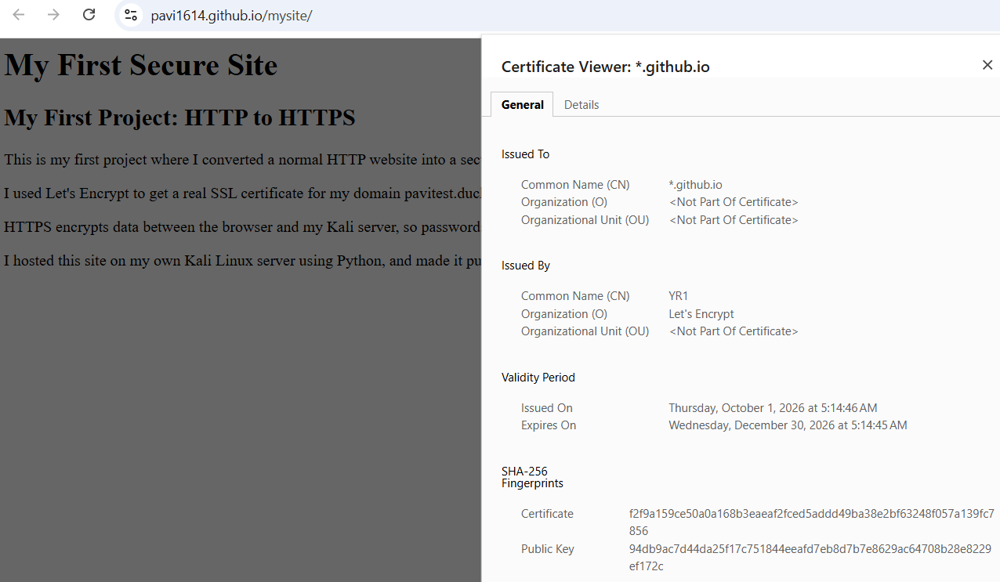
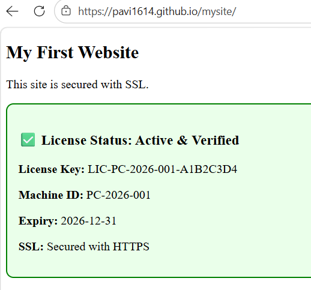

# MySite - HTTP to HTTPS

My first cybersecurity project.

## What I did
- Made a normal HTTP website
- Got SSL certificate from Let's Encrypt
- Made it safe with HTTPS

## Certificate Details
- Provider: Let's Encrypt
- Validity: 90 days
- Renewal: Auto-renewable

## Live Website
Hosted with GitHub Pages

## What I learned
How HTTPS protects data, how SSL works, and why auto-renewal is important.

## Output

